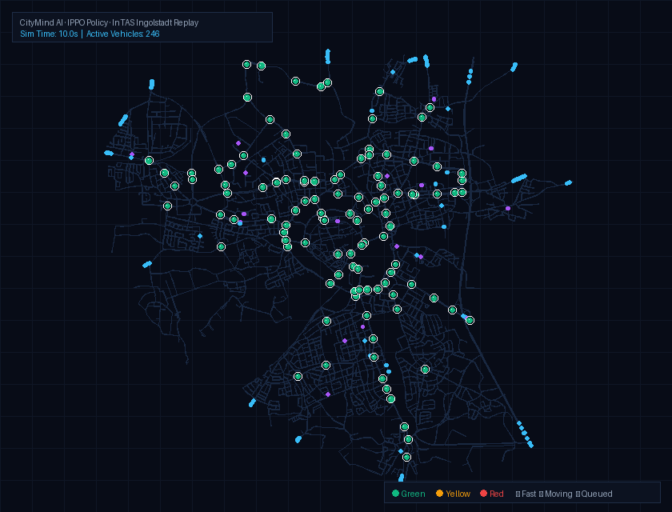

# CityMind AI — Reinforcement Learning for Traffic Signal Control

CityMind AI is a reproducible research and engineering platform evaluating whether deep reinforcement learning (RL) can optimize network-wide traffic signals across a real-world city grid (the Ingolstadt InTAS scenario in Eclipse SUMO), compared with conventional fixed-time and Max-Pressure controllers.



---

## 🎯 Core Research Question

> **Can deep-RL traffic-signal control reduce congestion and travel delay compared to fixed-time and Max-Pressure control under identical simulation conditions — and does giving each intersection its own agent and reward (rather than one policy jointly controlling all of them) change the answer?**

The project trained and evaluated **two RL architectures** against the same two classical baselines, on the same 98-intersection network, same seed, same demand:

1. **PPO (Centralized)** — one policy observes the entire network and jointly outputs an action for every intersection (`MultiBinary(98)`). This is the project's original design.
2. **IPPO (Parameter-Shared, decentralized)** — one shared policy is invoked independently per intersection, each seeing only a fixed-size local observation and receiving its own local reward (`Discrete(2)`: extend or switch). Built after the centralized design was diagnosed with a credit-assignment failure (see [Results](#-results-seed-42-10-demand) below) — one global reward gave no per-intersection agent a way to tell whether *its own* action helped or hurt.

---

## 📊 Results (07:00-08:00 peak demand, mean ± std over 3 seeds)

Two corrections behind this table, both load-bearing: earlier results were measured on a **midnight window** (1,486 departures/hour vs. peak's 14,500+) against a baseline mislabeled "fixed-time" that was actually **SUMO's own calibrated vehicle-actuated control** (`sumo_actuated` below) — a materially higher bar than a real fixed timer (`fixed_time` below, InTAS's own static programs). Separately, every controller's per-step departure/arrival counters were undercounting by roughly 5× (sampled once every 5 simulation seconds using TraCI's since-last-call counters, without accumulating the 4 seconds in between) — fixed alongside adding trip-level metrics (`trips_completed`, `mean_trip_timeloss`, from SUMO's own `--tripinfo-output`) and backlog/teleport counts, which is what surfaced the finding below in the first place.

| Controller | Trips Completed | Mean TimeLoss (s) | Backlog | Teleports | Mean Wait (s) | Switches |
|---|---|---|---|---|---|---|
| **SUMO-Actuated (calibrated)** | **11,600** | **284.4 ± 1.3** | **3,257** | 7.7 | 6.06 ± 0.06 | 0 |
| Fixed-Time (static) | 11,454 | 301.8 ± 5.4 | 3,472 | 7.7 | 6.97 ± 0.18 | 0 |
| Max-Pressure | 10,408 | 342.9 ± 4.9 | 3,755 | 50.3 | 12.62 ± 0.21 | ~11,962 |
| PPO (Centralized) | 9,546 | 354.7 ± 0.6 | 4,112 | 19.0 | 7.61 ± 0.25 | ~31,265 |
| IPPO (Parameter-Shared) | 9,520 | 347.8 ± 2.1 | 4,086 | 10.0 | **5.26 ± 0.13** | ~40,342 |
| IPPO Phase-Select (`ippo_phase_select`, see Update below) | 9,441 ± 42 | 291.5 ± 1.5 | 4,420 ± 30 | 712.7 ± 7 | 34.10 ± 0.26 | — |

**None of the four RL variants beats the baselines** — on trips completed or mean trip timeloss (the two metrics sourced from completed trips, not in-network sampling), both rank last. IPPO's mean waiting time *looks* best (5.26s vs. actuated's 6.06s), but that number is measured only over vehicles currently in the network — and IPPO completes 18% fewer trips than actuated control while leaving 26% more vehicles stuck in the network at episode end (backlog). That combination is starvation, not faster service: some vehicles get through quickly while a growing pool never clears. The mechanism is visible in the switch count — IPPO's shared policy changes phase roughly 40,000 times across the hour (98 agents × 720 decisions ≈ 57% of all opportunities), well past anything a real signal engineer would run, which resets in-network waiting-time counters without moving the queue that matters.

The root cause is the action space, not the algorithm: every controller here (RL and baseline alike) can only keep or advance to the *next* phase in a fixed cycle — never jump straight to whichever approach is actually congested. Three independent training runs (centralized PPO, IPPO, IPPO with neighbor observations) converged to the same result under this constraint.

**Update — phase-selection, final result:** a phase-selection action space (`Discrete(6)`, action-masked per intersection via MaskablePPO, controller id `ippo_phase_select`) was built and trained to address the action-space limitation above. The first attempt failed worse than every baseline (severe gridlock — see the full diagnosis on the app's **Story** page or `PROJECT_RESEARCH_AND_VISION.md`), traced to a reward that didn't credit the agent for relieving congestion it wasn't currently serving. That reward was fixed (a "neglected pressure" term, restored waiting-delta, a 6× cut to the switching penalty) and the model was retrained for the full 100 episodes (interrupted twice by infrastructure issues along the way, resumed cleanly from checkpoint both times — not a policy failure).

The fix worked, measurably and reproducibly (±0.4% variance across 3 seeds): trips completed rose 22% and teleports fell 61% versus the first attempt, and mean trip timeloss (291.5s) is now the second-best of all six controllers, beaten only by the calibrated actuated baseline. **It still doesn't beat the baselines** — teleports remain ~90× every baseline's, and trips completed/backlog still trail all four. The honest state of this repo is: two real measurement bugs found and fixed, a harder action-space redesign built and proven to work mechanically, a reward flaw diagnosed and corrected with a real, reproducible improvement — and still no RL controller here beats calibrated actuated signal control. Reported directly, not around.

---

## 🏛️ Architecture & Formulation

- **Microscopic Traffic Engine**: Eclipse SUMO + TraCI.
- **Scenario**: InTAS (Ingolstadt Traffic Scenario) — a realistic, validated urban network with **98 signalized intersections**.
- **Action Space**: Binary per intersection — `0` (maintain current phase) or `1` (advance to next phase).
- **Safety Layer**: Shared by every controller (RL and baseline alike) — enforces minimum/maximum green time and mandatory yellow/all-red clearance intervals; no controller can request an unsafe transition.
- **Observation Space**:
  - *Centralized PPO*: one large vector concatenating every intersection's per-lane queues, densities, speeds, and phase state, plus global network stats.
  - *Decentralized IPPO*: a fixed 10-dimensional vector per intersection (phase timing, own-lane queue/speed/density aggregates, a downstream-neighbor queue signal, and two network-wide totals) — fixed-size so one shared network can be invoked for every intersection despite InTAS's TLS ranging from 4–19 lanes and 3–11 phases.
- **Baselines**: Fixed-time (InTAS's own default cycle) and Max-Pressure (queue-pressure differential).
- **RL Algorithm**: Proximal Policy Optimization (PPO) via Stable-Baselines3 for both architectures — IPPO trains the same SB3 `PPO` class on a PettingZoo `ParallelEnv` wrapped with SuperSuit so 98 independent agents share one set of weights.

---

## 📂 Repository Structure

```text
├── configs/                  # Environment, PPO, and IPPO hyperparameters
├── data/                     # InTAS scenario files, processed network GeoJSON
├── src/
│   ├── scenario/              # Scenario inspection, TLS metadata extraction
│   ├── environment/            # Centralized + decentralized Gymnasium/PettingZoo envs, safety, rewards, metrics
│   ├── controllers/            # Baselines (Fixed-Time, Max-Pressure)
│   ├── agents/                 # PPOAgent and IPPOAgent wrappers
│   └── evaluation/              # Paired evaluation, statistical comparison, XAI
├── api/                       # FastAPI backend serving metrics, replay, network geometry, XAI
├── frontend/                  # React + TypeScript Vite dashboard
├── artifacts/                 # Metrics, trained checkpoints, trajectories, reports
├── scripts/                   # CLI entrypoints (training, evaluation, visual demo, XAI, GIF export)
└── tests/                     # Pytest unit and integration test suites
```

---

## 🚀 Quickstart

### 1. Requirements
- macOS (Apple Silicon M-series recommended) or Linux
- Python 3.11+ (`uv` recommended)
- Eclipse SUMO 1.20+ with `SUMO_HOME` exported

### 2. Environment Setup
```bash
# Verify SUMO and clone the InTAS scenario
chmod +x scripts/setup_sumo.sh
./scripts/setup_sumo.sh

# Create the Python virtual environment and install dependencies
uv venv .venv --python 3.11
source .venv/bin/activate
uv pip install -e ".[dev]"
```

### 3. Workflow Progression
1. **Inspect the scenario**: `python -m src.scenario.inspect_intas`
2. **Train**:
   - Centralized PPO: `python scripts/run_training.py --ppo-config configs/ppo.yaml`
   - Decentralized IPPO: `python scripts/run_ippo_training.py --ippo-config configs/ippo.yaml`
3. **Evaluate & compare against baselines**:
   ```bash
   python scripts/run_evaluation.py \
     --sumo-cfg data/raw/intas/scenario/InTAS_buildings.sumocfg \
     --tls-json artifacts/scenario/tls_metadata.json \
     --ppo-model artifacts/experiments/ppo/<run_id>/model_final.zip \
     --ippo-model artifacts/experiments/ippo/<run_id>/model_final.zip \
     --output-dir artifacts/metrics --plot
   ```
4. **Watch it live** (SUMO-GUI, any of the 4 controllers, including side-by-side):
   `python scripts/run_visual_demo.py --controller ippo`
5. **Generate XAI explanations**: `python scripts/run_xai.py --model artifacts/experiments/ppo/<run_id>/model_final.zip --tls-json artifacts/scenario/tls_metadata.json`
6. **Launch the dashboard**:
   - Backend: `uvicorn api.main:app --reload --port 8000`
   - Frontend: `cd frontend && npm install && npm run dev`

### Further reading
- [`CLAUDE_AGENT_HANDOVER.md`](CLAUDE_AGENT_HANDOVER.md) — operational notes on the SUMO/TraCI performance work and the original centralized-PPO XAI engine (predates IPPO; kept as historical record of the perf investigation).
- [`PROJECT_RESEARCH_AND_VISION.md`](PROJECT_RESEARCH_AND_VISION.md) — the original research proposal (predates IPPO and the final scope; several ideas in it, like the full DQN/A2C experiment matrix across multiple demand levels, were superseded by the centralized-vs-decentralized PPO comparison actually run).
